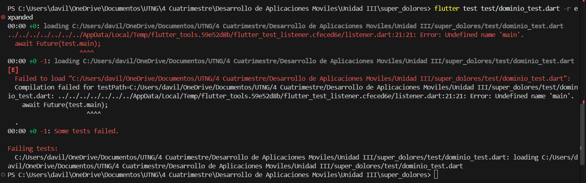
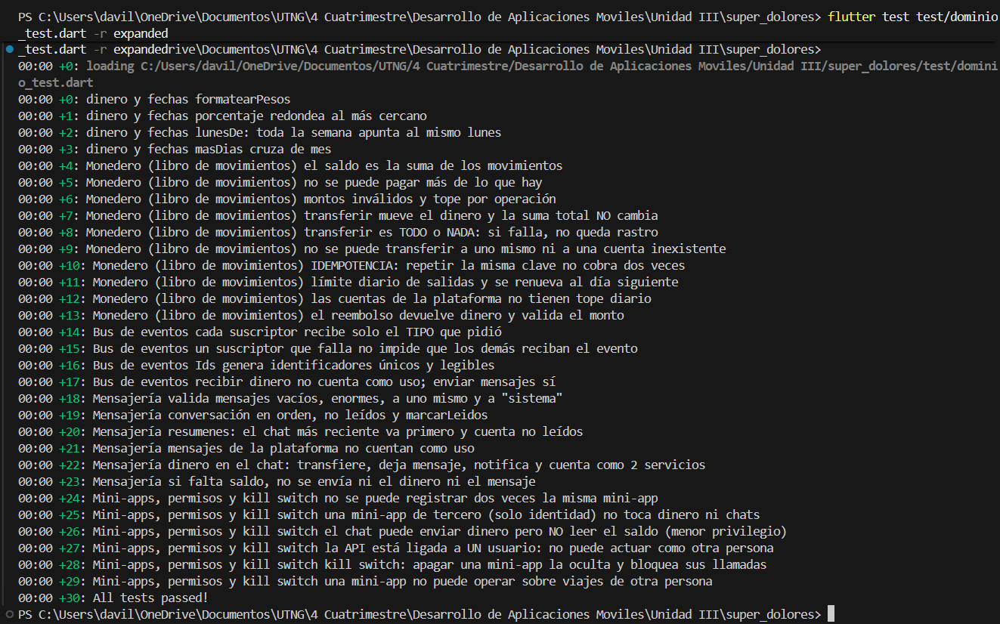
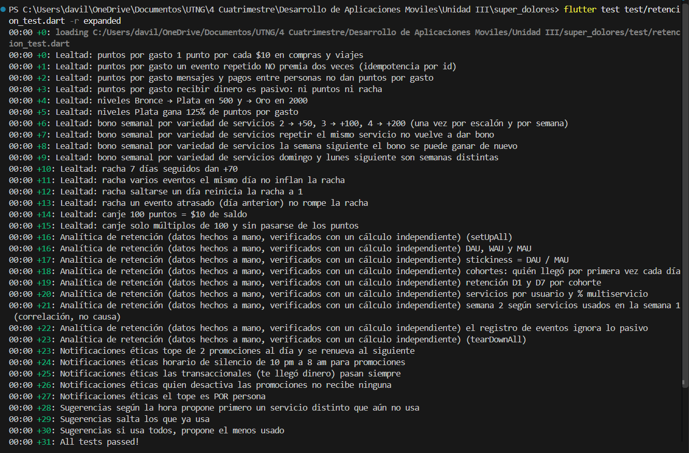
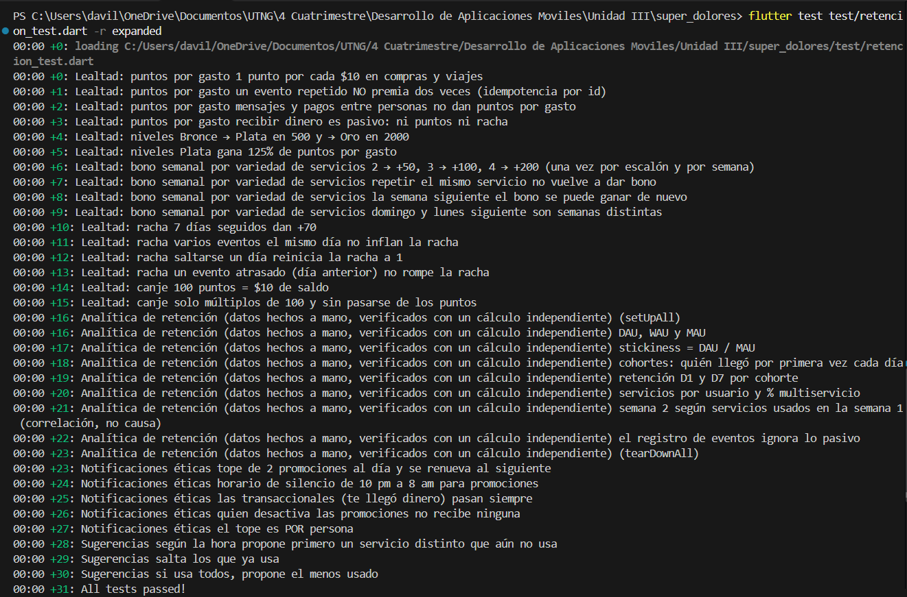
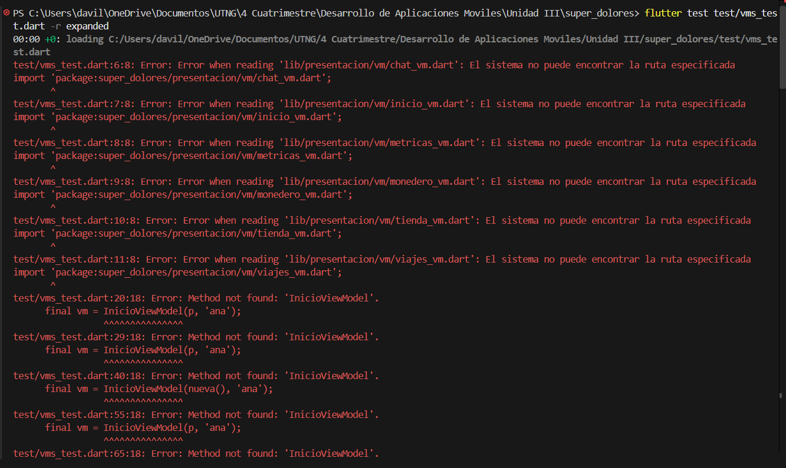
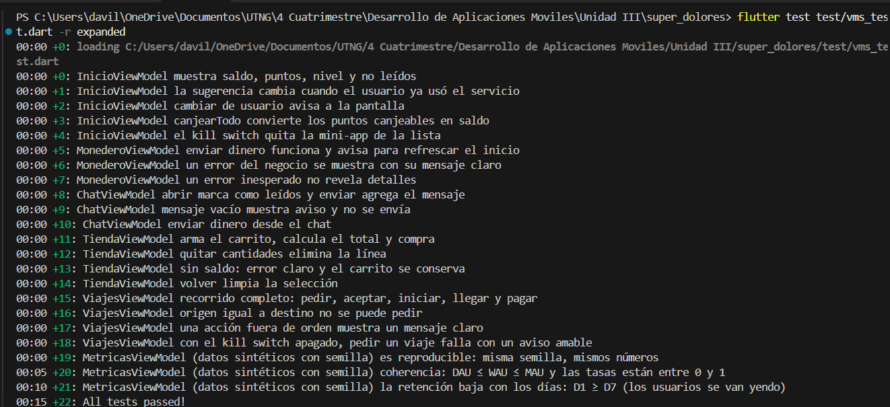
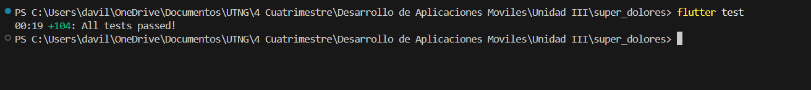

# Super Dolores

SuperApp didáctica de Dolores Hidalgo (mensajería, monedero, comercio y transporte en un solo ecosistema), construida con pruebas unitarias y ViewModels en Flutter[cite: 3].

---

## 1. Dominio (`dominio_test.dart`)

Rojo: las pruebas de dominio fallan antes de completar las reglas y modelos base[cite: 3].

[cite: 3]

Verde: pasan las pruebas de dominio[cite: 3].

[cite: 3]

---

## 2. Retención, lealtad y analítica (`retencion_test.dart`)

Verde: pasan las pruebas de lealtad, métricas de retención, notificaciones éticas y sugerencias[cite: 3].

[cite: 3]

---

## 3. Servicios (`servicios_test.dart`)

Verde: pasan las pruebas de comercio y transporte[cite: 3].

[cite: 3]

---

## 4. ViewModels (`vms_test.dart`)

Rojo: las pruebas de ViewModels fallan antes de implementar la capa de presentación[cite: 3].

[cite: 3]

Verde: pasan las pruebas de los ViewModels[cite: 3].

[cite: 3]

---

## 5. Resultado final de pruebas

Verde: pasan todas las pruebas del proyecto[cite: 3].

[cite: 3]

---

## Pantallas funcionando

<table>
  <tr>
    <td align="center">
      
      
<strong>Pantalla 1</strong>

    </td>
    <td align="center">
      
      
<strong>Pantalla 2</strong>

    </td>
    <td align="center">
      
      
<strong>Pantalla 3</strong>

    </td>
  </tr>
  <tr>
    <td align="center">
      
      
<strong>Pantalla 4</strong>

    </td>
    <td align="center">
      
      
<strong>Pantalla 5</strong>

    </td>
    <td align="center">
      
      
<strong>Pantalla 6</strong>

    </td>
  </tr>
  <tr>
    <td align="center">
      
      
<strong>Pantalla 7</strong>

    </td>
    <td></td>
    <td></td>
  </tr>
</table>

